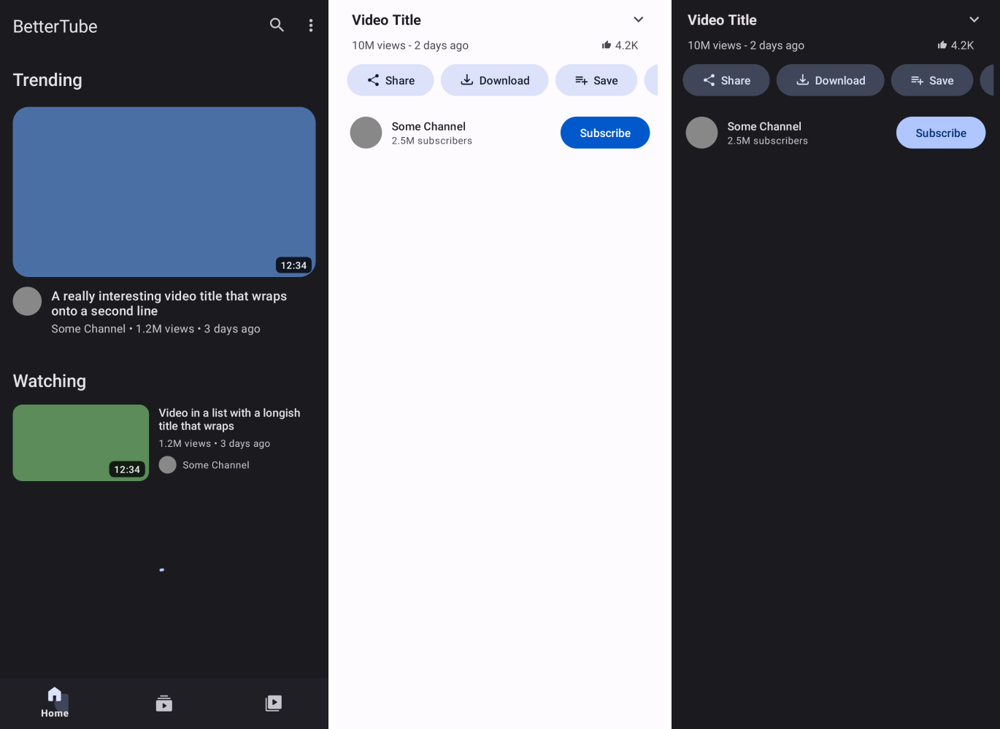
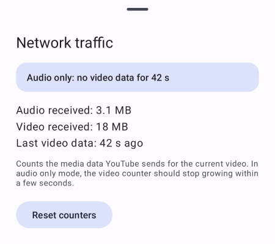

<div align="center">

# BetterTube

**A privacy-friendly YouTube client for Android, forked from [LibreTube](https://github.com/libre-tube/LibreTube).**<br>
BetterTube keeps everything LibreTube does and focuses on two things: audio-only mode that really saves data, and a cleaner, more refined interface.

[](https://www.gnu.org/licenses/gpl-3.0.en.html)

</div>

> [!IMPORTANT]
> BetterTube is an independent fork and is **not affiliated with or endorsed by the LibreTube team**.
> Please report BetterTube problems [here](../../issues), not to LibreTube.

<div align="center">
  
  <br>
  <sub>Rendered from the app's layouts. Coloured boxes stand in for thumbnails and channel pictures.</sub>
</div>

## What's different from LibreTube

| | LibreTube | BetterTube |
|---|---|---|
| **Switching to audio-only mid-video** | Keeps downloading the video stream in the background, wasting data and memory | Stops requesting video right away and only downloads audio |
| **Checking what's being downloaded** | Not possible in the app | Live **Network traffic** readout of audio vs. video data |
| **Loading indicator** | Shape-shifting "blob" in a filled circle | Slim round spinner in your accent colour |
| **Look and feel** | Material 3 Expressive defaults | Refined Material 3: flatter cards, consistent spacing, lighter typography |

### 🎧 Audio-only mode that actually saves data

Most YouTube videos are now streamed with a protocol called SABR, where the app tells YouTube's server which audio and video streams it wants.
In LibreTube, if you start a video and then switch to audio-only, the app keeps telling the server it still wants video. The server keeps sending it, and the app quietly downloads and stores video it never plays.

BetterTube tells the server to stop sending video as soon as video is turned off, and safely ignores any video data that was already on its way. Switching back to video works as before.

### 📊 See it for yourself: Network traffic



While a video is playing, open **⋮ → Network traffic** (also under *Stats for nerds* in the player). It shows, live:

- how much **audio** and **video** data has been received for the current video
- how long ago the last video data arrived
- a status line such as *"Audio only: no video data for 42 s"*

Switch to audio-only and the video counter stops growing within a few seconds.

<br clear="right">

### ✨ Refined interface

- Slim, round-capped loading spinner (white when shown over video)
- Slimmer bottom navigation bar on a soft tinted surface
- Feed cards with wider margins, rounder 20dp thumbnails and no drop shadows
- List rows aligned to the same 16dp margin, medium-weight titles, softer secondary text
- Compact pill buttons and a tidier channel row on the player page
- Watch-progress bar follows your chosen accent colour
- Works in light and dark mode with all of LibreTube's colour themes

## Download

There are no official releases yet. Every push is built automatically by GitHub Actions:

1. Open the [latest successful build](../../actions/workflows/ci.yml?query=is%3Asuccess) and sign in to GitHub.
2. Under **Artifacts**, download **app** (a zip file).
3. Unzip it and install `app-debug.apk`. Android may ask you to allow installs from your browser or file manager.

> [!NOTE]
> These are debug builds. They install as **BetterTube** alongside the official LibreTube app instead of replacing it.

## Everything else from LibreTube

BetterTube includes all of LibreTube's features:

- No ads or tracking
- Subscriptions and subscription groups
- Playlists, playlist bookmarks and watch/search history
- Downloads and background playback
- Optional accounts via [Piped](https://github.com/TeamPiped/Piped)
- [SponsorBlock](https://sponsor.ajay.app/), [Return YouTube Dislike](https://www.returnyoutubedislike.com/) and [DeArrow](https://dearrow.ajay.app/)

For questions about these features, see LibreTube's [FAQ](https://libre-tube.github.io/#faq).

## Building from source

Requirements: JDK 17 and the Android SDK (platform 36).

```sh
./gradlew assembleDebug
# APK: app/build/outputs/apk/debug/app-debug.apk
```

### Keeping up with LibreTube

```sh
git remote add upstream https://github.com/libre-tube/LibreTube.git
git fetch upstream master
git merge upstream/master
```

## Credits and license

BetterTube is built on [LibreTube](https://github.com/libre-tube/LibreTube) by Bnyro and the LibreTube contributors. Nearly all of the app is their work. If you find it useful, consider [supporting LibreTube](https://github.com/sponsors/Bnyro).

App icons by [XelXen](https://github.com/XelXen) and [Margot Albert-Heuzey](https://margotdesign.ovh).

Like LibreTube, BetterTube is licensed under the [GNU General Public License v3.0](LICENSE).
