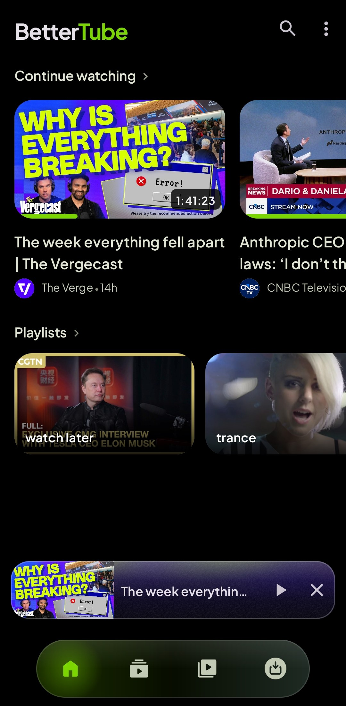

<div align="center">

# BetterTube

**A privacy-friendly YouTube client for Android, forked from [LibreTube](https://github.com/libre-tube/LibreTube).**<br>
BetterTube keeps everything LibreTube does and focuses on two things: audio-only mode that really saves data, and a calm, modern interface with its own typeface, a floating dock and fluid motion.

[](https://www.gnu.org/licenses/gpl-3.0.en.html)

</div>

> [!IMPORTANT]
> BetterTube is an independent fork and is **not affiliated with or endorsed by the LibreTube team**.
> Please report BetterTube problems [here](../../issues), not to LibreTube.

<div align="center">
  
  <br>
  <sub>Home on a real phone, with the floating dock.</sub>
</div>

## What's different from LibreTube

- **Audio-only mode actually saves data.** In LibreTube, switching to audio-only mid-video keeps downloading the video stream in the background. BetterTube stops it right away and only downloads the audio. A small label in the player shows the data used, so you can see the difference.
- **A complete visual redesign.** A calmer, modern look throughout: its own typeface, a floating dock, a minimal audio player, smoother motion and a cleaner layout on every screen.

Everything else LibreTube offers is still there.

## Download

**[Download the latest release](../../releases)**: grab `BetterTube-<version>.apk` under *Assets* and open it on your phone. Android may ask you to allow installs from your browser or file manager.

The current release is a **preview** (`v0.1.8-preview`), signed with BetterTube's public debug key: only install BetterTube updates from this repository.

Want the very latest changes? Every push is also built by GitHub Actions: open the [latest successful build](../../actions/workflows/ci.yml?query=is%3Asuccess), sign in to GitHub, download **app** under *Artifacts*, unzip it and install `app-debug.apk`.

> [!NOTE]
> - These are debug builds. They install as **BetterTube** alongside the official LibreTube app instead of replacing it.
> - All builds are signed with the same key, so a new build installs as an **update** and keeps your data. The build number is shown in Android's app info (e.g. version `32.1-ci.14`).
> - Builds from before 19 November 2026 used a different key each time: uninstall that version once (export a backup first), then install the new one.

## Changelog

### 20 November 2026: refinements
- Audio player uses the video page's layout: the artwork sits exactly where the video goes, tap the title for the description, the current chapter appears under the title, a **Video** pill sits on the artwork, and switching between audio and video is a smooth transition that keeps the picture in place
- Video lists: short ages (7h, 3d, 2w), smaller and quieter channel/views/age, a smaller separator dot
- Home: smaller section headings with a subtle chevron, tighter spacing between sections
- Floating dock sits a bit higher above the screen edge
- Library: a small + pill next to "Playlists", sorting on the right
- One standard search icon everywhere (also in Downloads and playlists)

### 19 November 2026 (later): polish
- One design language: the darker tone and soft accent gradient of the mini player now carry across the dock, chips, Subscribe / Play all / play buttons and the tonal buttons
- Dock: the active tab glows instead of sitting in a pill
- Library: your watch history is now the main feed, with a horizontal carousel of playlists (and bookmarks) on top; the + for new playlists moved next to the Playlists heading, away from the dock and mini player
- Subscriptions: the filter row is hidden by default (Settings → Appearance → *Subscriptions toolbar* to show it)
- Data label: no longer tappable, just shows the total
- Audio player: the back chevron and ⋮ menu are the same size
- Playback errors no longer close the player: BetterTube retries automatically with a fresh stream at the same position, and a **Retry** button appears on the video (and in the audio player) if that doesn't work
- Fixed the app crashing when opening the Library tab (v0.1.2-preview)
- Fixed taps on the open player (e.g. on the data label) reaching the screen behind it and starting a video
- LibreTube's update checker is turned off; Settings → *BetterTube releases* opens this repository's releases page


### 19 November 2026: the BetterTube redesign

**Audio-only and data**
- Switching to audio-only mid-video now really stops video downloads (the SABR client stops requesting video and ignores video data already on its way)
- Data label in both players (🎬 / 🔊 icon + total); tap for a live audio vs. video breakdown

**Design**
- Plus Jakarta Sans typeface across the whole app, on the full Material 3 type scale
- Floating, icons-only bottom dock: opaque surface with a soft colour sheen in your accent colours, a fine rim and a shadow; content scrolls underneath it
- Header (bold BetterTube wordmark) scrolls fully away with the content and returns when scrolling up
- New feed cards: large rounded thumbnails, full-width titles, one quiet line with a small avatar, channel, views and age
- Flat, outline-free chips; quiet empty states; one filled primary action per screen; everything on a 16dp grid
- Redesigned screens: Home, Subscriptions, Library, Search, Channel, Playlist, video page, comments, bottom sheets, dialogs and settings headings
- Slim round loading spinner, and pulsing card-shaped placeholders on Home and Subscriptions

**Motion**
- New screen transitions: screens rise into place on emphasized easing; going back mirrors it
- Lists ease in item by item; cards and rows give a gentle press response
- Opening a video: the tapped thumbnail (including DeArrow thumbnails) stays in place and fades into the first frame

**Players**
- Minimal audio player: no previous/next buttons, a round play button that never shifts its neighbours, Chapters and Video as the only quick actions; queue, speed, sleep timer, autoplay and sharing in ⋮; blurred-artwork backdrop (Android 12+)
- Video page: actions are Share, Audio, Save, Download (PiP and Screenshot removed; PiP still works when leaving the app); quiet full-width Comments row
- Video controls: soft gradients instead of a flat dark overlay; autoplay moved from the top-bar switch into the ⚙ menu; round play button
- Mini player is a floating rounded card above the dock (video and audio)

**Subscriptions and Library**
- Subscriptions: one header row with the channel list, a channel-group selector (incl. "Edit groups") and the filter
- Library: compact Watch history and Downloads shortcuts

**Fixes**
- Fixed a minimised player sometimes switching to another video when tapping the screen behind it
- Fixed the data label showing "audio only" while a video was playing

**Under the hood**
- App renamed to BetterTube
- Ships with a set of default settings, applied once on first start without overwriting existing ones
- Debug builds are signed with a shared key so new builds install as updates; CI uploads the APK for every push

## Everything else from LibreTube

BetterTube includes all of LibreTube's features:

- No ads or tracking
- Subscriptions and subscription groups
- Playlists, playlist bookmarks and watch/search history
- Downloads and background playback
- Optional accounts via [Piped](https://github.com/TeamPiped/Piped)
- [SponsorBlock](https://sponsor.ajay.app/), [Return YouTube Dislike](https://www.returnyoutubedislike.com/) and [DeArrow](https://dearrow.ajay.app/)

For questions about these features, see LibreTube's [FAQ](https://libre-tube.github.io/#faq).

## Building from source

Requirements: JDK 17 and the Android SDK (platform 36).

```sh
./gradlew assembleDebug
# APK: app/build/outputs/apk/debug/app-debug.apk
```

### Keeping up with LibreTube

```sh
git remote add upstream https://github.com/libre-tube/LibreTube.git
git fetch upstream master
git merge upstream/master
```

## Credits and license

BetterTube is built on [LibreTube](https://github.com/libre-tube/LibreTube) by Bnyro and the LibreTube contributors. Nearly all of the app is their work. If you find it useful, consider [supporting LibreTube](https://github.com/sponsors/Bnyro).

App icons by [XelXen](https://github.com/XelXen) and [Margot Albert-Heuzey](https://margotdesign.ovh).

[Plus Jakarta Sans](https://github.com/tokotype/PlusJakartaSans) by Tokotype, used under the SIL Open Font License 1.1 (see `app/src/main/assets/licenses/PlusJakartaSans-OFL.txt`).

Like LibreTube, BetterTube is licensed under the [GNU General Public License v3.0](LICENSE).
